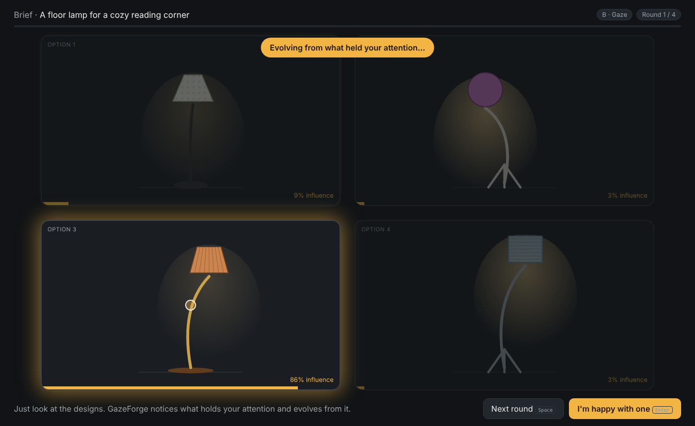

# GazeForge: steering generative design with where you look

GazeForge is an HCI research prototype. It asks whether **implicit gaze feedback** can steer a generative design tool, and whether that is better than the usual "pick one, re-prompt, repeat" loop.

The system shows 4 design options per round and measures how long you look at each one and how often you come back to it. It then evolves the next round toward the designs that held your attention. You never have to click.



## Research questions

| | Question | Measures |
|---|---|---|
| RQ1 | Does gaze steering reduce effort and time compared with explicit selection? | time to final, rounds, NASA-TLX, SUS |
| RQ2 | Does it change how broadly people explore? | design-space diversity |
| RQ3 | Does attention actually predict choice? | dwell share → P(click), max-dwell = final pick |

**Conditions (within-subjects, counterbalanced):**
- **A: Explicit.** Click the best option.
- **B: Gaze.** Just look; rounds advance on a timer or with Space.
- **C: Hybrid.** Gaze steers, and a click strongly favours one option.

## Architecture

```
web/                    Browser app (vanilla JS ES modules, no build step)
  js/gaze.js            MediaPipe FaceLandmarker → iris + head-pose features → ridge regression → One-Euro filter
  js/genome.js          Parametric design space, gaze-weighted interactive evolution, prompt builder, SVG mock renderer
  js/app.js             Session flow: calibration → rounds → final pick → questionnaires → summary
  js/logger.js          Session JSON + tidy CSV export
  js/questionnaires.js  NASA-TLX (raw) + SUS
backend/server.py       FastAPI: serves the app, bridges to the ComfyUI API, saves logs to data/
backend/workflows/      ComfyUI API-format workflow (SDXL-Turbo, 4 steps)
analysis/analyze.R      Mixed-effects models (lme4) + figures; runs on real data or --simulate
tests/                  Playwright end-to-end test, fake ComfyUI server, calibration-math test
```

**How steering works:** each design is a genome of 8 genes (shade, colour, material, height, arm, base, glow, pattern).
- After each round, every option gets an attention score: `dwell + 250 ms × revisits`.
- The scores are sharpened (power 1.5) and normalised into weights.
- The best option is carried over (elitism). Three children are bred by weighted crossover and mutation. Mutation strength σ starts high (exploring) and decays over rounds (refining).
- The same genome becomes either an SVG lamp (mock mode) or a text prompt plus seed (ComfyUI mode). A child keeps its parent's seed 70% of the time, so the composition stays stable.

**Gaze pipeline:**
- Pilot finding: with a MacBook webcam, iris *height* barely changed between looking up and down (vertical error 385 px), but **eyelid aperture** did, because the upper lid follows vertical gaze. Adding it as a feature and choosing the model on post-calibration validation dots (which capture natural head drift) brought the validation error from **388 px to 53–88 px**, well under the size of one design card.
- Features: eyelid aperture, MediaPipe eyeLook* blendshapes, iris offset in each eye, normalised by eye width; head forward vector; nose position; inter-ocular distance (a proxy for distance to the screen).
- Calibration collects 13 points and fits several ridge-regression feature sets. 5 validation points shown afterwards pick the most robust model, which is then refit on all the data. There is also a head-pointing mode as a robust fallback.
- Blinks are detected from eye openness and filtered out.
- Dwell is only counted after 100 ms on a card, so quick passes over a card during a saccade don't count.

## Quick start

```bash
cd backend
pip install -r requirements.txt
python server.py                # mock mode → open http://localhost:8000
```

Choose **Mouse as gaze** to try it right away, or **Webcam** to run the real gaze pipeline. The webcam needs internet access the first time, to load MediaPipe from the CDN.

Keys: `Space` next round · `Enter` done · `G` gaze cursor · `H` live attention glow.

### With real image generation on a Mac (Apple Silicon), two commands

```bash
bash setup_comfyui.sh        # one time: ComfyUI + PyTorch (MPS) + SDXL-Turbo (6.9 GB) into ~/ComfyUI
bash start_with_comfyui.sh   # every time: starts ComfyUI (8188) + GazeForge in ComfyUI mode (8000)
```
Or double-click **Setup ComfyUI.command** once, then **Start GazeForge with ComfyUI.command**. On an M-series Mac, a round of 4 SDXL-Turbo images (512×512, 4 steps) takes about 6.5 s on the GPU.
If your Anaconda is the Intel (x86_64) build, the setup script still creates a native arm64 environment (`CONDA_SUBDIR=osx-arm64`) so PyTorch can use the GPU.
Then choose Generator → **ComfyUI via backend** in the app.

### With real image generation (ComfyUI), manual / remote GPU

1. Install [ComfyUI](https://github.com/comfyanonymous/ComfyUI) on a machine with a GPU.
2. Put `sd_xl_turbo_1.0_fp16.safetensors` in `ComfyUI/models/checkpoints/`.
3. Start ComfyUI (`python main.py`, which serves on port 8188).
4. Start the bridge:
   ```bash
   GF_MODE=comfy COMFY_URL=http://127.0.0.1:8188 python server.py
   ```
5. In the app, set Generator → **ComfyUI via backend**.

To use your own workflow (Flux, ControlNet, IP-Adapter), go to ComfyUI → Settings → enable Dev mode → *Save (API Format)*. Then point the bridge at it with `GF_WORKFLOW=path.json`. Name your prompt nodes `positive` and `negative`. Every seed input is overwritten automatically, and `GF_CKPT` swaps the checkpoint.

If ComfyUI runs on a remote GPU (lab machine or DRAC), forward the port: `ssh -L 8188:localhost:8188 user@host`.

## Running a session

1. Seat the participant about 60 cm from the screen, in full-screen (F11), with even lighting on the face.
2. Calibrate. Validation error under 8% of the screen width is good, because each card is about 40% of the width.
3. Run conditions A, B and C in counterbalanced order, using the same brief or matched briefs.
4. Logs save automatically to `data/` (and can also be downloaded as JSON/CSV).
5. Run `Rscript analysis/analyze.R` to fit the models and draw the figures.

> Running this as a study at York requires approval from the Human Participants Review Committee. Informal pilots with labmates are fine for development.

## Tests

```bash
cd backend && python server.py &                                             # mock, :8000
cd tests && python -m uvicorn fake_comfy:app --port 8188 &                    # fake ComfyUI
cd ../backend && GF_MODE=comfy GF_PORT=8001 python server.py &                # bridge → fake ComfyUI
cd ../tests && python e2e_test.py http://localhost:8000 http://localhost:8001 # all 3 conditions + ComfyUI path
node ridge_test.mjs                                                           # calibration regression on synthetic data
node real_data_test.mjs ../data/<session>.json                                # re-fit the gaze model on a recorded session
Rscript ../analysis/analyze.R --simulate                                      # analysis pipeline
```

## Roadmap

- [x] Browser MVP: webcam gaze, 3 conditions, evolution, logging, questionnaires, analysis
- [ ] Wizard-of-Oz pilot and formative interviews with designers (personas, journey map)
- [ ] Unity 6 + XR Interaction Toolkit version on Meta Quest Pro (native eye tracking)
- [ ] Image-to-3D (Hunyuan3D / TRELLIS in ComfyUI) to place generated objects in the VR room
- [ ] CLIP-embedding diversity metric for real images
- [ ] Full study (N ≈ 12–16) → CHI Late-Breaking Work / UIST poster

## Author
Shabnam Shirdel, Centre for Vision Research, York University
